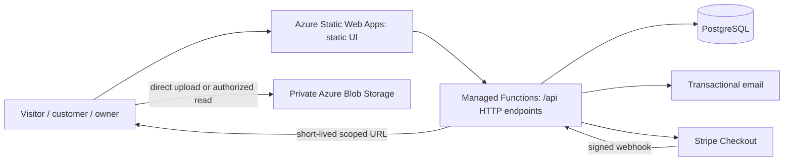

# Architecture

## Decision

Use a static React/TypeScript frontend built by Vite, with TypeScript HTTP APIs in Azure Static Web Apps managed Azure Functions (Node.js 22), PostgreSQL, private Azure Blob Storage, Stripe Checkout, and a transactional email provider. Prefer SQL migrations and `pg` with bounded pooled connections over a large ORM. Validate request and response schemas at API boundaries.

This is a plan, not an already implemented integration. The foundation milestone must prove deployment, runtime, raw webhook-body handling, database connectivity, and same-origin session cookies on Azure before feature work expands.

## Boundaries and cost constraints

- Managed SWA Functions support HTTP triggers, not timer/queue triggers or Durable Functions. Keep requests below the documented 45-second limit.
- Media bytes never pass through an API function or ship in the SWA build. Admin uploads directly to Blob Storage; the API verifies metadata and finalizes an asset.
- Do not assume managed identity, Key Vault references, private endpoints, or fixed outbound IPs in the managed API tier. Use tightly scoped app settings with rotation procedures. PostgreSQL must offer an authenticated TLS endpoint reachable from SWA; evaluate exposure and regional placement in the deployment spike.
- Use a pooled serverless PostgreSQL provider for the initial cost evaluation, with Neon as the first candidate. Azure Database for PostgreSQL Flexible Server remains an all-Azure option with a different baseline cost. The application uses portable PostgreSQL; no vendor auth/database API dependency.
- Use bounded connection pools per function instance and a provider pooler. Dedicated migration connections use a separate least-privilege migration credential and a lock. No migrations on ordinary HTTP requests.
- No mandatory scheduler in v1. A durable email outbox is attempted synchronously after commit, with owner-visible failed deliveries and manual retry/reconciliation. A later scheduled worker needs a separate architecture and cost decision. This tradeoff must be explicit in the operations UI and release tests.

## Identity

Owner: SWA's preconfigured GitHub or Microsoft identity, plus a deployment-configured provider and immutable user ID. Every owner endpoint checks that exact identity. An `authenticated` role alone is insufficient. No first-login owner claiming and no public owner signup. Recovery updates the configuration through a documented trusted deployment process.

Customers: email magic links backed by random, hashed, expiring, one-use tokens and opaque sessions. Consume links only after an explicit confirmation POST so mail scanners cannot burn them. Store the session ID hash in PostgreSQL; cookie is Secure, HttpOnly, SameSite=Lax, host-only, and rotated on login. Rate-limit issuance and verification using shared persistence, return enumeration-resistant responses, and never log tokens. Origin/CSRF validation protects all cookie-authenticated mutations.

SWA routes can guard owner screens, but APIs enforce owner identity and customer entitlements independently. Do not put customer routes behind SWA's `authenticated` role: their email session is application-owned. Forged identity headers must not work outside the platform boundary; verify this in Azure and forbid production dev-auth bypasses.

## Purchase integrity

1. API reads the published product and server-side price. It creates a pending checkout and a Stripe Checkout Session with an idempotency key and opaque reference.
2. A verified webhook checks the raw body signature, provider mode, authoritative payment state, currency, and purchased item snapshot.
3. A PostgreSQL transaction records the unique event ID, payment transition, order, entitlement, and email outbox entry. Unique provider IDs prevent duplicates, including concurrent delivery.
4. Acknowledge only after durable processing; transient errors return retryable failure. Email transport failures do not undo payment or access. The return page only observes state.
5. Guest checkout email does not create a logged-in session. Access requires proof of control of that email. Existing sessions cannot claim another email's purchase.
6. Reconciliation checks authoritative Stripe objects for missed, late, refund, and dispute events. Terminal refunds must not be undone by a late paid event.

Customers can have multiple purchase records but a unique effective customer/product entitlement. An entitlement remains active if another valid paid or complimentary grant exists. Refund processing revokes the associated grant, not unrelated purchases of the same product.

## Content security

Private storage by default. Issue a blob-specific, short-lived upload SAS to the owner only; never a container-wide read/list token. Finalization checks expected path, actual size/type, and product ownership. Azure SAS alone does not enforce upload size, so enforce quotas at issuance/finalization and clean up rejected objects. Quarantine new files until validation completes; reject active content and don't unpack user ZIPs on the server. Malware scanning needs a documented provider or owner trust policy and cost assessment before public uploads are considered.

For each read URL, verify session, entitlement, product state policy, and resource relationship. A download link expires after 5 minutes. Video links may last up to a configured short playback window (initial target 15 minutes) and refresh only while entitlement is valid; test seeking after refresh. Range requests go to storage. Revocation prevents new links immediately; already issued links remain valid until expiry. Access URLs are bearer secrets: redact query strings, use a strict referrer policy, avoid third-party scripts on learning screens, and set private/no-store API caching. This is access control, not DRM.

## Data model

| Entity | Invariants |
| --- | --- |
| shop_settings | Exactly one singleton row; currency immutable after first live sale unless migrated |
| products, product_versions | Unique slug; typed course/download; publication snapshot; archive preserves purchases |
| sections, lessons, lesson_resources | Ordered within parent; no orphan resources; preview flag explicit |
| assets | Private object key, validated MIME/size, lifecycle, version; no durable signed URL |
| customers, login_tokens, sessions | Normalized email strategy; token/session hashes; expiration |
| checkout_attempts | Server-owned item/price snapshot, unique idempotency key and session ID |
| orders, order_items, refunds | Unique provider identifiers, integer money plus currency, immutable purchase snapshot |
| entitlement_grants, entitlements | Purchase/complimentary grant sources; unique effective customer/product access |
| lesson_progress | Unique customer/lesson, bounded resume position, completion independent of seek position |
| webhook_events, email_outbox | Unique event ID; transactional durability; retry state without payment duplication |
| audit_events | Owner actions and entitlement transitions, redacted payloads, retention policy |

Store timestamps as UTC instants, display in the configured shop timezone, and define calendar-based drip behavior explicitly later. Use restrictive foreign keys for purchased content; archive instead of deleting sold products.

## Static publishing and SEO

Public product pages need HTML metadata, canonical URLs, sitemap entries, and structured product/course data. Use a publish-triggered static export/rebuild with only public catalog data; keep the last successful version until the new build succeeds. Drafts and paid lesson content must never enter public build artifacts. Owner publishing distinguishes saving a record from the public site becoming live. Publication uses a narrowly scoped deployment credential stored server-side; no GitHub token in the browser. Dynamic API reads can improve freshness but must not be the only source of crawlable product metadata. Foundation and storefront issues validate this approach before launch.

## Deployment layout (planned)

`apps/web/` static app; `api/` managed Functions; `packages/contracts/` shared schemas; `db/migrations/` SQL; `infra/` Bicep; `tests/` integration/e2e. Keep the current `design/` prototype separate from production output.

References: [managed Functions](https://learn.microsoft.com/en-us/azure/static-web-apps/apis-functions), [API constraints](https://learn.microsoft.com/en-us/azure/static-web-apps/apis-overview), [runtimes](https://learn.microsoft.com/en-us/azure/static-web-apps/languages-runtimes), [Stripe fulfillment](https://docs.stripe.com/checkout/fulfillment), [Blob SAS](https://learn.microsoft.com/en-us/azure/storage/blobs/sas-service-create-javascript). Reviewed 2026-11-14.
